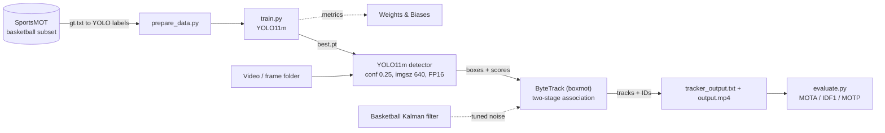

# Basketball Player Tracking - YOLO11 + ByteTrack

A modular, Dockerized **multi-object tracking (MOT)** pipeline for basketball broadcast video: a YOLO11m detector feeds a ByteTrack tracker with a basketball-tuned Kalman filter, so players keep persistent IDs through screens and occlusions. Built as an engineering assessment (see [Task.md](Task.md)) on the SportsMOT dataset.

[](https://www.python.org/)
[](https://github.com/ultralytics/ultralytics)
[](Dockerfile)

Docs site: [the-harsh-vardhan.github.io/Basketball-Player-Tracking](https://the-harsh-vardhan.github.io/Basketball-Player-Tracking/)

## What it does

- **Data pipeline**: isolates the basketball subset of SportsMOT and converts MOT `gt.txt` into normalized YOLO annotations.
- **Detection**: trains YOLO11m (logged to Weights & Biases) with the model choice justified by an mAP vs speed trade-off.
- **Tracking**: wraps boxmot's ByteTrack and patches in a Kalman filter tuned for fast basketball motion (position noise 1/15, velocity noise 1/100).
- **Inference**: detect, track, then write `tracker_output.txt` (MOT format) and an annotated `output.mp4`.
- **Evaluation**: MOTA, IDF1 and MOTP via py-motmetrics.
- **Reproducible**: one `docker-compose` service per stage (data-prep, trainer, tracker, evaluator).

## Architecture



## Status

- Implemented: data preparation, training entry point, tracking wrapper, inference pipeline, evaluation script, Docker setup, and unit tests for the Kalman filter and MOT parser (`tests/`).
- **Not yet recorded in this repo**: a training run, MOTA/IDF1 results, FPS measurement and a public W&B dashboard. The figures in the "Detection model" table below are published Ultralytics benchmark numbers, not measurements from this project; the >30 FPS figure is the assignment target. See [#3](https://github.com/The-Harsh-Vardhan/Basketball-Player-Tracking/issues/3).

## Quick Start

### Prerequisites

- Docker with NVIDIA GPU support ([nvidia-container-toolkit](https://docs.nvidia.com/datacenter/cloud-native/container-toolkit/install-guide.html))
- SportsMOT dataset downloaded to `data/SportsMOT/` (see [Dataset Setup](#dataset-setup))

### Docker (Recommended)

```bash
# Build the container
docker-compose build

# Step 1: Prepare dataset
docker-compose run data-prep

# Step 2: Train detector
docker-compose run trainer

# Step 3: Run inference
docker-compose run tracker --source /app/data/video.mp4

# Step 4: Evaluate
docker-compose run evaluator --gt-dir /app/data/SportsMOT/dataset/val --pred-dir /app/outputs/predictions
```

### Local Setup

```bash
# Create virtual environment
python -m venv venv
source venv/bin/activate  # Linux/Mac
# venv\Scripts\activate   # Windows

# Install dependencies
pip install -r requirements.txt

# Step 1: Prepare dataset
python scripts/prepare_data.py --dataset-root data/SportsMOT --output-dir data/basketball_yolo

# Step 2: Train YOLO11m
python scripts/train.py --config configs/dataset.yaml --epochs 100

# Step 3: Run inference
python scripts/run_inference.py --source data/SportsMOT/dataset/val/<sequence>/img1/

# Step 4: Evaluate
python scripts/evaluate.py --gt-file data/SportsMOT/dataset/val/<seq>/gt/gt.txt --pred-file outputs/tracker_output.txt
```

## Dataset Setup

This pipeline uses the **SportsMOT** dataset (ICCV 2023), specifically the basketball subset.

1. Download from [CodaLab](https://codalab.lisn.upsaclay.fr/competitions/12424)
2. Extract to `data/SportsMOT/`
3. Run `python scripts/prepare_data.py` to:
   - Filter basketball sequences using `splits_txt/basketball.txt`
   - Convert MOT-format `gt.txt` → normalized YOLO annotations
   - Organize into `data/basketball_yolo/{images,labels}/{train,val}/`

Expected structure:
```
data/SportsMOT/
├── splits_txt/
│   ├── basketball.txt    # Basketball sequence names
│   ├── train.txt         # Training split
│   └── val.txt           # Validation split
└── dataset/
    ├── train/<seq>/gt/gt.txt, img1/, seqinfo.ini
    └── val/<seq>/gt/gt.txt, img1/, seqinfo.ini
```

## Architectural Decisions

### 1. Detection Model: YOLO11m

Published Ultralytics COCO benchmark figures (not measured in this project):

| Model | mAP@50:95 | Inference (T4) | FPS (T4) | Decision |
|-------|-----------|---------------|----------|----------|
| YOLO11n | 39.5 | 1.5ms | 667 | Too low mAP |
| YOLO11s | 47.0 | 2.5ms | 400 | Acceptable |
| **YOLO11m** | **51.5** | **4.7ms** | **213** | **Selected** ✓ |
| YOLO11l | 53.4 | 6.2ms | 161 | Diminishing returns |
| YOLO11x | 54.7 | 11.3ms | 88 | Overkill for single-class |

**Rationale**: YOLO11m offers the best mAP-to-speed tradeoff. At the published 213 FPS detection + ~1ms ByteTrack overhead, the pipeline operates well above the 30 FPS requirement. The 51.5 mAP provides robust detection under occlusion and varied lighting.

### 2. Tracking Engine: ByteTrack (via boxmot)

ByteTrack's two-stage association is specifically advantageous for basketball:

- **Stage 1** (high-confidence): IoU-based matching of confident detections to existing tracks
- **Stage 2** (low-confidence): Matches remaining tracks against low-confidence detections — this rescues partially occluded players during screens

We use the `boxmot` library (v16+) for a battle-tested ByteTrack implementation, focusing our engineering effort on Kalman Filter tuning rather than algorithm reimplementation.

### 3. Kalman Filter Tuning for Basketball Dynamics

| Parameter | Default | Basketball-Tuned | Rationale |
|-----------|---------|-----------------|-----------|
| `_std_weight_position` | 1/20 (0.050) | **1/15 (0.067)** | Basketball players move 3-8 m/s. Larger position uncertainty prevents the filter from "locking" during fast crossovers. |
| `_std_weight_velocity` | 1/160 (0.00625) | **1/100 (0.010)** | High jerk: players accelerate/decelerate rapidly (cuts, screens, sprints). Larger velocity noise allows faster adaptation. |

The noise is proportional to bounding box height — a built-in scaling proxy for camera distance. Farther players have smaller boxes and proportionally smaller pixel-space motion.

### 4. ByteTrack Hyperparameters

```yaml
track_thresh: 0.5   # Screen detections score 0.1-0.5, captured by Stage 2
match_thresh: 0.8   # Liberal IoU match — basketball players are well-separated
track_buffer: 75    # 3s at 25 FPS — covers boundary re-entry window
frame_rate: 25      # SportsMOT native frame rate
min_hits: 3         # Require 3 consecutive detections to confirm a track
```

## Edge Case Analysis

### 1. The "Screen" Test (5-10 frame occlusion)

**Scenario**: Player A sets a screen, completely obscuring Player B for 5-10 frames.

**How ByteTrack handles it**:
1. When the occluded player's detection confidence drops (partial occlusion), Stage 2 matching catches these low-confidence detections and associates them with the existing track via Kalman-predicted position.
2. During complete occlusion (0 frames of detection), the track enters "lost" state. The Kalman filter continues predicting position using the learned velocity.
3. When the player emerges, the predicted position is close enough for IoU matching to succeed, preserving the original track ID.
4. Our tuned KF (higher velocity noise) keeps predictions accurate during the acceleration changes that often accompany screens.

**Expected behavior**: ID is preserved through 5-10 frame occlusions in most cases. The `track_buffer=75` ensures lost tracks survive far longer than needed.

### 2. Boundary Exit (3-second re-entry)

**Scenario**: A player exits the camera frame and re-enters 3 seconds later (~75 frames at 25 FPS).

**How our system handles it**:
- `track_buffer=75` keeps the lost track alive for the full 3-second window
- The Kalman filter continues predicting position (will drift significantly over 75 frames)
- **Re-identification depends on re-entry location**:
  - If the player re-enters **near their exit point** (e.g., same side of court), IoU-based matching can re-associate the track. **ID is preserved**.
  - If the player re-enters **at a distant location** (e.g., ran across behind the camera), the predicted position will be too far for IoU matching. **A new ID is assigned**.

**Documented assumption**: This is a fundamental limitation of motion-only tracking (ByteTrack). Without appearance-based re-identification (ReID), there is no mechanism to match players across large spatial gaps. For production use, we recommend BoTSORT with a lightweight ReID model (e.g., OSNet) — boxmot supports this with a one-line configuration change.


## Weights & Biases

Training is logged to W&B (loss curves, mAP@50 and mAP@50:95 per epoch, model artifacts). No public dashboard link has been published yet.

To enable W&B:
```bash
export WANDB_API_KEY=your_key_here
# Or copy .env.example to .env and fill in your key
```

## Evaluation

Targets from the assignment: MOTA above 70%, IDF1 above 65%, more than 30 FPS on a T4. Results will be reported here once a run is evaluated.

```bash
python scripts/evaluate.py \n    --gt-dir data/SportsMOT/dataset/val \n    --pred-dir outputs/predictions \n    --output-json outputs/eval_results.json
```

## Environment Reproduction

### Docker (single command)

```bash
docker-compose build
docker-compose run tracker --source /app/data/video.mp4
```

### Manual

```bash
pip install -r requirements.txt
# Requires: CUDA 12.1+, Python 3.11+
```

## Tech stack

Python 3.11+, Ultralytics YOLO11, boxmot (ByteTrack), py-motmetrics, Weights & Biases, OpenCV, NumPy, SciPy, Docker / docker-compose.

## Project structure

```
├── configs/
│   ├── dataset.yaml              # YOLO dataset config
│   └── tracker.yaml              # ByteTrack hyperparameters
├── src/
│   ├── data/
│   │   ├── download.py           # Dataset validation & instructions
│   │   ├── filter_basketball.py  # SportsMOT basketball subset isolation
│   │   └── parse_mot.py          # gt.txt → YOLO annotation converter
│   ├── detection/
│   │   └── train.py              # YOLO11 training with W&B
│   ├── tracking/
│   │   ├── bytetrack.py          # ByteTrack wrapper
│   │   └── kalman_filter.py      # Basketball-tuned KalmanFilterXYAH
│   ├── evaluation/
│   │   └── metrics.py            # MOTA, IDF1, MOTP computation
│   └── inference/
│       ├── pipeline.py           # End-to-end detect → track → output
│       └── visualize.py          # Video rendering with annotations
├── scripts/
│   ├── prepare_data.py           # Data preparation orchestrator
│   ├── train.py                  # Training entry point
│   ├── evaluate.py               # Evaluation entry point
│   └── run_inference.py          # Inference entry point
├── Dockerfile
├── docker-compose.yml
├── requirements.txt
└── tests/
```

## License

This project is for assessment purposes. SportsMOT dataset is subject to its [original license](https://github.com/MCG-NJU/SportsMOT).
