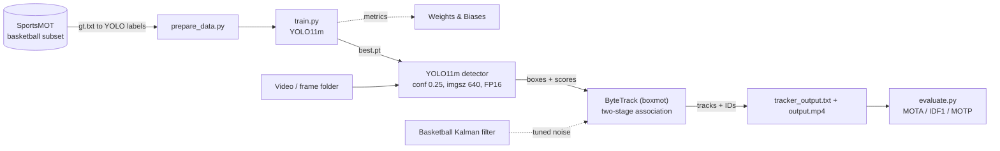

# Architecture

GitHub renders this diagram in the repository README; here it is shown as source.

## Components

- **Data** (`src/data/`): filters the basketball sequences and converts MOT `gt.txt` to YOLO labels.
- **Detection** (`src/detection/train.py`): YOLO11m training with W&B logging.
- **Tracking** (`src/tracking/`): ByteTrack wrapper and the basketball Kalman filter. ByteTrack's second association stage recovers partially occluded players; `track_buffer: 75` keeps lost tracks for 3 s at 25 FPS.
- **Inference** (`src/inference/`): detect, track, write MOT-format output and an annotated video.
- **Evaluation** (`src/evaluation/metrics.py`): MOTA, IDF1, MOTP with py-motmetrics.

## Known limitation

ByteTrack is motion-only, so a player who leaves the frame and re-enters far from the exit point gets a new ID. Appearance ReID (for example BoTSORT with OSNet) would be the next step.
